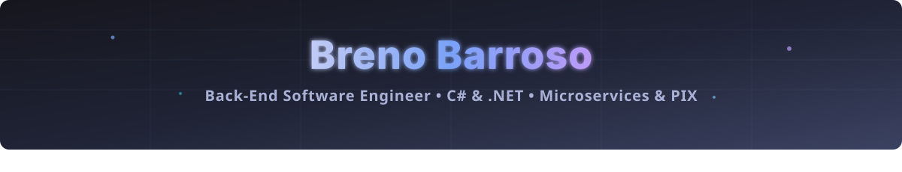

<!-- Animated Waving Header -->

<!-- Animated Typing SVG -->

 

<!-- Quick Links & Profile Views -->

---

## 👋 About Me

💻 **Back-End Software Engineer** & **Computer Science** @ UFS — Aracaju, SE, Brazil  
🏦 Specialized in building **high-criticality financial systems (PIX, Core Banking)** with strong ownership and business impact  
🕹️ Beyond corporate code: exploring **embedded systems (firmwares & RF)**, **Linux automation**, and **retro emulation setups (`Batocera.linux` & RK3326/RK3566 handhelds)**

### ⚡ Engineering Highlights & Real-World Impact
- 🏦 **Financial Core & PIX (Vindi / Pagcerto):** Engineered and deployed the *Mecanismo Especial de Devolução (MED)* for PIX, reliably handling high-volume financial transactions.
- 🚀 **Performance Optimization (-87% Execution Time):** Refactored critical regulatory processing routines (*DIMP*), cutting execution time from **2 hours down to 15 minutes**.
- 🚨 **Observability & Incident Response (+25% Faster):** Built automated monitoring and alerting pipelines that accelerated incident resolution by **25%**.
- 🤖 **Developer Productivity & Automation:** Created an internal Discord *Scrum Manager Bot* in C# / Node.js that reduced daily ceremony delays to **under 5%**, alongside AI-orchestrated automation tools in Python.

---

## 🛠️ Tech Stack

  

 

**Languages:**  

**Frameworks, Messaging & Architecture:**  

**Databases & Caching:**  

**DevOps & Systems:**  

---

## 🚀 Featured Projects

  
  
   
  
  

---

## 🏆 GitHub Trophies

  

---

## 📊 GitHub Stats

### 📌 Profile Summary

  

### 📌 Languages & Stats

  
  

### 📌 Commit Streak

  

### 📌 Activity Graph

  

---

## 🐍 Contributions

  <picture>
    <source media="(prefers-color-scheme: dark)" srcset="https://raw.githubusercontent.com/brenobarroso/brenobarroso/output/github-contribution-grid-snake-dark.svg" />
    <source media="(prefers-color-scheme: light)" srcset="https://raw.githubusercontent.com/brenobarroso/brenobarroso/output/github-contribution-grid-snake.svg" />
    
  </picture>

<!-- Animated Waving Footer -->

